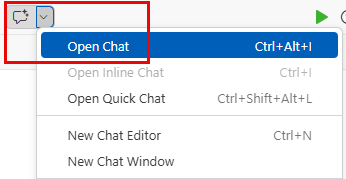
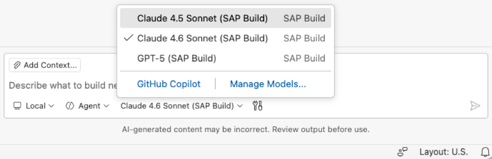
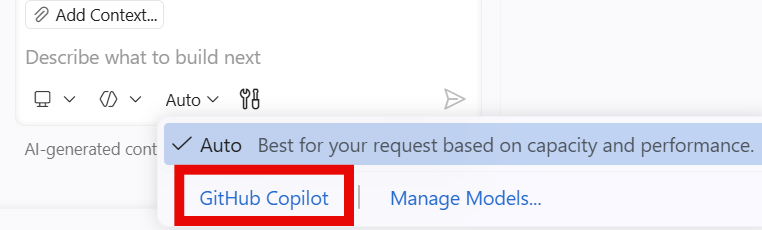
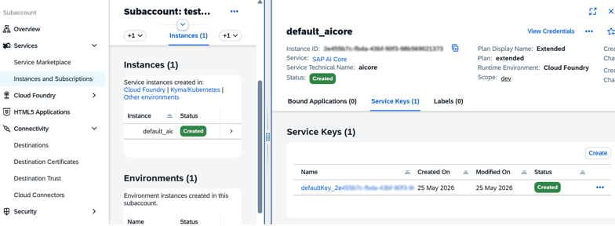
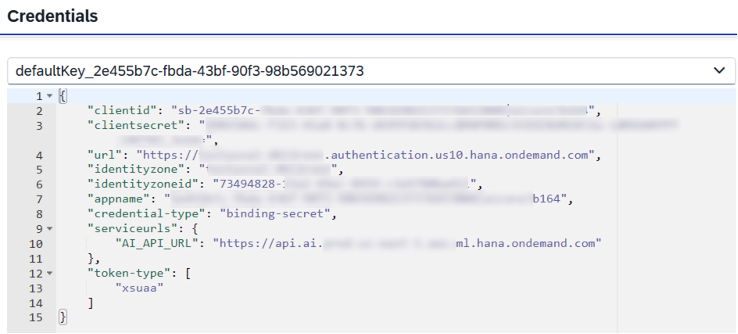
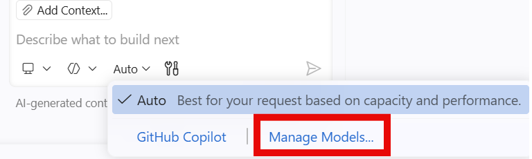
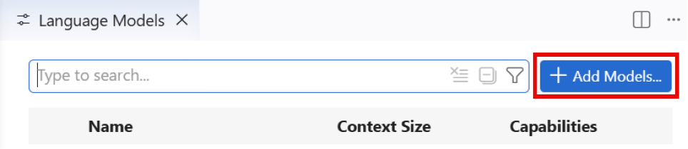
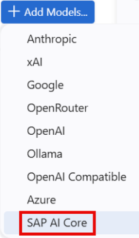
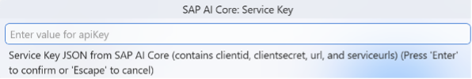
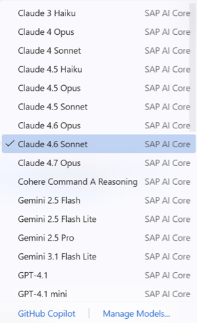

<!-- loio071e0b759ae4415e94a0dcaaecf99fd7 -->

# AI Chat

AI Chat is an AI-driven assistant that supports developers throughout the software development lifecycle.

It helps simplify everyday development tasks, reduce manual effort, and improve productivity so developers can spend more time building and innovating.

> ### Note:  
> AI Chat availability depends on administrative configuration. Administrators can disable AI features \(including AI Chat\) at the account level. For more information, see [Enable or Disable AI Features](https://help.sap.com/docs/bas/sap-business-application-studio/enable-or-disable-ai-features).

AI Chat allows you to:

-   Receive real-time coding recommendations while working in your IDE.

-   Interact conversationally to ask questions, troubleshoot issues, and get coding guidance.

-   Use AI-powered assistance directly from the command line for development workflows.

-   Provide project context to improve the quality and relevance of responses.

-   Automatically generate summaries and descriptions for code changes and pull requests.

-   Accelerate development tasks such as research, implementation planning, code generation, and pull request preparation for team review. Some advanced capabilities are available only in specific editions or subscription plans.

## Working with the AI Chat

To access the chat:

1.  From the upper toolbar, open the chat menu and select *Open Chat*.

    

2.  In the chat pane, sign in the following ways:
    -   Using your GitHub credentials.
        1.  Click *sign in with your GitHub credentials*.
        2.  Copy the code provided and use it to connect to GitHub.

    -   Using “bring your own key”. This means you connect your LLM provider’s service key in the chat, and choose which models that key unlocks. Once connected, you can use the models tied to that key in the chat.
        1.  Click *select a model*.
        2.  Click *\+ Add Models...* and select a model from the list provided.
        3.  Provide a group name and press Enter.
        4.  Provide your LLM provider’s service key. All the models available for your key are displayed.

> ### Note:  
> -   When using providers based on SAP AI Core \(for example, in bring-your-own-key \(BYOK\) scenarios or through SAP Build\), AI Chat supports the following model groups: Anthropic Claude Sonnet, Anthropic Claude Opus, GPT, and Gemini Pro. The availability of specific models is subject to change and depends on the models provided through SAP AI Core.
> -   If you are using your provider's key for the chat, you are responsible for managing any implications related to telemetry, data handling, and ensuring compliance with the terms of service of the selected AI provider.

## Working with the AI Chat

To access the chat:

From the upper toolbar, open the chat menu and select *Open Chat*.

In the chat pane, you can use AI Chat in the following ways:

### Using Preconfigured Models

If you are using **build-code** \(SAP Build Code\) or **build-default** \(SAP Build\) plans, preconfigured models are available without additional setup.

****Preconfigured models are provided for limited use and may change or be discontinued at any time. For production scenarios, use a configured provider \(such as SAP AI Core, a third-party LLM provider, or GitHub Copilot\).****

-   Model availability may be updated or limited.
-   AI model usage is subject to per-user fair-use limits.
-   SAP may adjust usage limits or restrict access to models or features.

### Using your GitHub Copilot Credentials

1.  Click *GitHub Copilot*.

    

2.  Copy the code provided and use it to connect to GitHub.

### Connect to a Third-Party LLM Provider or SAP AI Core

Use this option to connect a third-party LLM provider or SAP AI Core and access its models in AI Chat using your provider’s service key.

**Prerequisites \(SAP AI Core only\)**:

You have [provisioned SAP AI Core and SAP AI Launchpad](https://developers.sap.com/tutorials/ai-core-generative-ai.html#1c4f36d7-f345-4822-be00-c15f133ff7d8):

-   You have onboarded to **SAP AI Core** and **SAP AI Launchpad**.
-   The **AI Core extended plan** is enabled.
-   The required roles are assigned.

**Procedure**:

1.  \(SAP AI Core only\) Prepare a service key
    1.  Open the SAP AI Core instance.

        

    2.  Retrieve the service key from the SAP AI Core instance credentials.

        

    3.  \(Optional\) In SAP AI Launchpad, update the connection using the service key.

2.  Add a provider in AI Chat
    1.  Click *Manage Models...*.

        

    2.  Click *\+ Add Models...*

        

    3.  Select a provider:
        -   Third-party LLM provider, or
        -   *SAP AI Core*

            

    4.  Enter a name for the group.
    5.  Paste the provider's service key and press Enter.

        

3.  Select a model:
    1.  View the available models for the configured provider.
    2.  Select a model to use in AI Chat.

        

> ### Note:  
> When using providers based on SAP AI Core \(for example, when connecting using your provider's service key or through SAP Build plans\), AI Chat supports model groups such as Anthropic Claude Sonnet, Anthropic Claude Opus, GPT, and Gemini Pro. Availability of specific models depends on your SAP AI Core configuration and may change over time.

> ### Remember:  
> If you are using your provider's key in AI Chat, you are responsible for managing any implications related to telemetry, data handling, and compliance with the terms of service of the selected AI provider.

-   **[Development Scenarios with AI Chat](development-scenarios-with-ai-chat-1ac5995.md "Use AI Chat in SAP Business Application
                                Studio to
		explore services, generate CAP applications, and integrate external services or data
		products. ")**  
Use AI Chat in SAP Business Application Studio to explore services, generate CAP applications, and integrate external services or data products.

