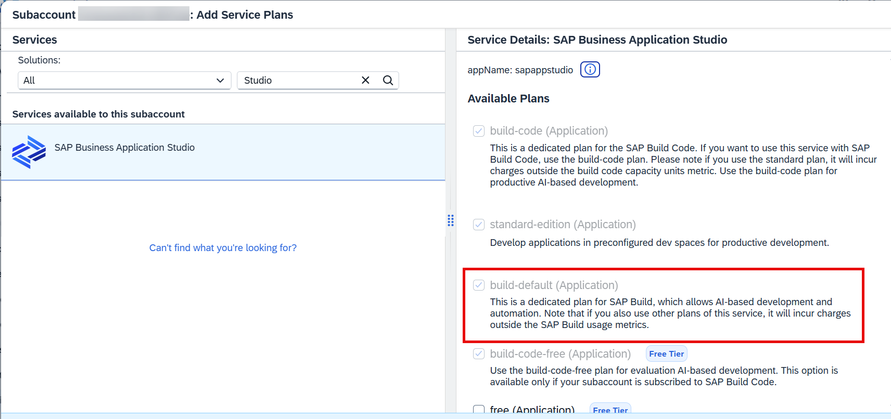
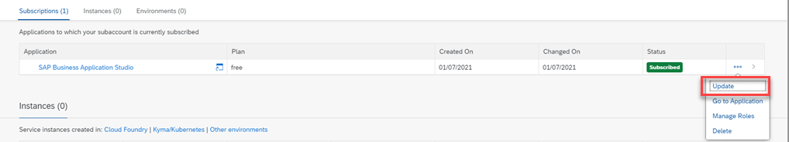
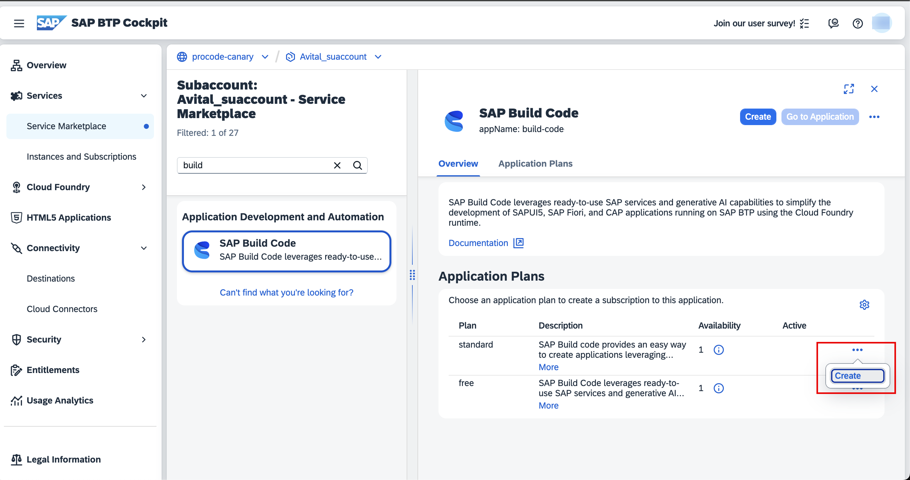
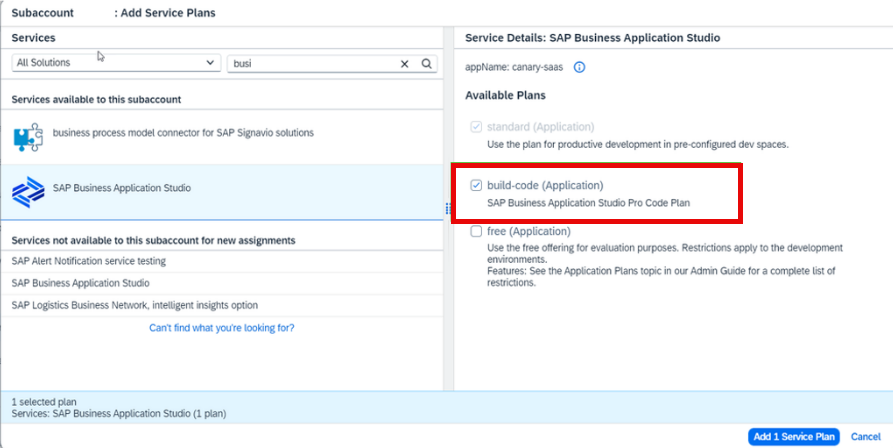

<!-- loio4cf7c698045346c5a9378c76016c72da -->

# Changing Plans

Learn about the options for moving to different SAP Business Application Studio service plans.

You can change the service plan for your SAP Business Application Studio subscription according to the rules described in the table.

Select your current service plan and your target service plan so learn about your options.

****

<table>
<tr>
<th valign="top">

Current Plan

</th>
<th valign="top">

Target Plan

</th>
<th valign="top">

Explanation

</th>
</tr>
<tr>
<td valign="top">

free

</td>
<td valign="top">

standard-edition

</td>
<td valign="top">

See [Updating from the free or build-code plan to the standard-edition plan](https://help.sap.com/docs/bas/sap-business-application-studio/changing-plans?version=Cloud#updating-from-the-free-or-build-code-plan-to-the-standard-edition-plan).

</td>
</tr>
<tr>
<td valign="top">

free

</td>
<td valign="top">

build-code

</td>
<td valign="top">

This transition is possible only if there already is an SAP Build Code subscription in the subaccount. See [Updating to the build-code plan](https://help.sap.com/docs/bas/sap-business-application-studio/changing-plans?version=Cloud#updating-to-the-build-code-plan).

</td>
</tr>
<tr>
<td valign="top">

free

</td>
<td valign="top">

build-code-free

</td>
<td valign="top">

In the cockpit, go to your subaccount and run the Get Started with SAP Build Code \(Free Plan\) booster. See [Initial Setup](https://help.sap.com/docs/build_code/d0d8f5bfc3d640478854e6f4e7c7584a/07698d7c31284e4db370acdf017cfd14.html?locale=en-US&state=PRODUCTION&version=SHIP).

</td>
</tr>
<tr>
<td valign="top">

free

</td>
<td valign="top">

build-default

</td>
<td valign="top">

This scenario is not supported.

</td>
</tr>
<tr>
<td valign="top">

standard-edition

</td>
<td valign="top">

build-code

</td>
<td valign="top">

This transition is possible only if there already is an SAP Build Code subscription in the subaccount. See [Updating to the build-code plan](https://help.sap.com/docs/bas/sap-business-application-studio/changing-plans?version=Cloud#updating-to-the-build-code-plan).

</td>
</tr>
<tr>
<td valign="top">

standard-edition

</td>
<td valign="top">

free

</td>
<td valign="top">

This scenario is not supported.

</td>
</tr>
<tr>
<td valign="top">

standard-edition

</td>
<td valign="top">

build-default

</td>
<td valign="top">

See [Updating to the build-default plan](https://help.sap.com/docs/bas/sap-business-application-studio/changing-plans?version=Cloud#updating-to-the-build-default-plan).

</td>
</tr>
<tr>
<td valign="top">

standard-edition

</td>
<td valign="top">

build-code-free

</td>
<td valign="top">

This scenario is not supported.

</td>
</tr>
<tr>
<td valign="top">

build-code

</td>
<td valign="top">

standard-edition

</td>
<td valign="top">

See [Updating from the free or build-code plan to the standard-edition plan](https://help.sap.com/docs/bas/sap-business-application-studio/changing-plans?version=Cloud#updating-from-the-free-or-build-code-plan-to-the-standard-edition-plan).

</td>
</tr>
<tr>
<td valign="top">

build-code

</td>
<td valign="top">

free

</td>
<td valign="top">

This scenario is not supported.

</td>
</tr>
<tr>
<td valign="top">

build-code

</td>
<td valign="top">

build-default

</td>
<td valign="top">

See [Updating to the build-default plan](https://help.sap.com/docs/bas/sap-business-application-studio/changing-plans?version=Cloud#updating-to-the-build-default-plan).

</td>
</tr>
<tr>
<td valign="top">

build-code

</td>
<td valign="top">

build-code-free

</td>
<td valign="top">

This scenario is not supported.

</td>
</tr>
<tr>
<td valign="top">

build-code-free

</td>
<td valign="top">

free

</td>
<td valign="top">

Follow the instructions in the [Changing to a Different Plan](https://help.sap.com/docs/build_code/d0d8f5bfc3d640478854e6f4e7c7584a/d501fb669447478cbcd07a0b7b7ca4c0.html?version=SHIP#changing-to-a-different-plan) section.

> ### Note:  
> This will remove the following:
> 
> -   Lobby
> 
> -   Joule features
> 
> -   All the dev spaces and their content

</td>
</tr>
<tr>
<td valign="top">

build-code-free

</td>
<td valign="top">

build-default

</td>
<td valign="top">

See [Updating to the build-default plan](https://help.sap.com/docs/bas/sap-business-application-studio/changing-plans#updating-to-the-build-default-plan).

</td>
</tr>
<tr>
<td valign="top">

build-code-free

</td>
<td valign="top">

standard-edition

</td>
<td valign="top">

This scenario is not supported.

</td>
</tr>
<tr>
<td valign="top">

build-code-free

</td>
<td valign="top">

build-code

</td>
<td valign="top">

See [Updating to the build-code plan](https://help.sap.com/docs/bas/sap-business-application-studio/changing-plans?version=Cloud#updating-to-the-build-code-plan).

</td>
</tr>
<tr>
<td valign="top">

build-default

</td>
<td valign="top">

standard-edition

</td>
<td valign="top">

This scenario is not supported.

</td>
</tr>
<tr>
<td valign="top">

build-default

</td>
<td valign="top">

free

</td>
<td valign="top">

This scenario is not supported.

</td>
</tr>
<tr>
<td valign="top">

build-default

</td>
<td valign="top">

build-code

</td>
<td valign="top">

This scenario is not supported.

</td>
</tr>
<tr>
<td valign="top">

build-default

</td>
<td valign="top">

build-code-free

</td>
<td valign="top">

This scenario is not supported.

</td>
</tr>
</table>

<a name="loio4cf7c698045346c5a9378c76016c72da__update-build-default"/>

## Updating to the build-default plan

> ### Note:  
> If you want to move to the `build-default` plan, you need to have SAP Build set up in your system. See [Initial Setup of SAP Build](https://help.sap.com/docs/build-service/build-service-guide/initial-setup-of-sap-build?version=Cloud).

1.  Open your global account in the cockpit.
2.  Go to your subaccount.
3.  In the navigation area, choose *Entitlements*.
4.  Search for SAP Business Application Studio, and under *Available Plans,* select *build-default \(Application\)*.

    

5.  In the navigation area, choose *Instances and Subscriptions*.

    A list of the applications to which your subaccount is subscribed in the Cloud Foundry environment is displayed.

6.  Search for SAP Business Application Studio.
7.  Select the ellipsis at the end of the subscription row, and from the menu, click *Update*.

    

8.  In the wizard that opens, select the `build-default` plan, and click *Update Subscription*.
9.  Follow the steps in [Migrate to the Identity Authentication Service](migrate-to-the-identity-authentication-service-56e1d0c.md).

<a name="loio4cf7c698045346c5a9378c76016c72da__section_dzc_j1z_tpb"/>

## Updating to the build-code plan

You can update from the`standard-edition`, `free`, or `build-code-free` plan to the `build-code` plan.

> ### Note:  
> If you want to move to the build-code plan, you need to have a subscription to SAP Build Code.
> 
> 1.  In the navigation area, choose *Service Marketplace*.
> 2.  Search for `Build Code`.
> 3.  Under *Application Plans*, click the 3 dots in the line for the standard plan, and click *Create*.
> 
>     

1.  Open your global account in the cockpit.
2.  Go to your subaccount.
3.  In the navigation area, choose *Entitlements*.
4.  Search for SAP Business Application Studio, and under *Available Plans,* select *build-code \(Application\)*.

    

5.  In the navigation area, choose *Instances and Subscriptions*.

    A list of the applications to which your subaccount is subscribed in the Cloud Foundry environment is displayed.

6.  Search for SAP Business Application Studio.
7.  Select the ellipsis at the end of the subscription row, and from the menu, click *Update*.

    

8.  In the wizard that opens, select the `build-code` plan, and click *Update Subscription*.

<a name="loio4cf7c698045346c5a9378c76016c72da__section_gpl_y5c_1bc"/>

## Updating from the free or build-code plan to the standard-edition plan

1.  Open your global account in the cockpit.
2.  Go to your subaccount.
3.  In the navigation area, choose *Instances and Subscriptions*.

    A list of the applications to which your subaccount is subscribed in the Cloud Foundry environment is displayed.

4.  Search for SAP Business Application Studio.
5.  Select the ellipsis at the end of the subscription row, and from the menu, click *Update*.

    

6.  In the wizard that opens, select the standard-edition plan, and click *Update Subscription*.

    > ### Note:  
    > If you don't see the standard-edition plan in the list, make sure that there's an entitlement for SAP Business Application Studio in your subaccount. See [Configure Entitlements and Quotas for Subaccounts](https://help.sap.com/products/BTP/65de2977205c403bbc107264b8eccf4b/5ba357b4fa1e4de4b9fcc4ae771609da.html).

> ### Note:  
> -   The content of the existing dev spaces is not affected by the update.
> 
> -   No changes are made to the user permissions.
> 
> -   The free tier restrictions are not applied anymore.
> 
> -   Restart your dev space to see the extended disk space.

