<!-- loio1ac59957a09a4e83a57fd95f270e7dc1 -->

# Development Scenarios with AI Chat

Use AI Chat in SAP Business Application Studio to explore services, generate CAP applications, and integrate external services or data products.


## Prerequisites

To use AI Chat, ensure that you have access to AI Chat in SAP Business Application Studio, provided by one of the following:

-   A configured third-party LLM provider or SAP AI Core \(using a provider’s service key\), or
-   A supported SAP Business Application Studio plan \(for example, **build-default**or **build-code**\) that includes preconfigured models

For more information, see [Using Preconfigured Models](ai-chat-071e0b7.md#loio071e0b759ae4415e94a0dcaaecf99fd7__preconfigured) and [Connect to a Third-Party LLM Provider or SAP AI Core](ai-chat-071e0b7.md#loio071e0b759ae4415e94a0dcaaecf99fd7__byok) in the AI Chat topic.


## Explore Services

Use AI Chat to explore a service and retrieve available information such as service details, entities, and, if available, live data.

> ### Note:  
> Service exploration covers SAP system service providers, including catalogs, service hosts, and service URLs.


### Prerequisites

Ensure that at least one relevant system is configured in your account.

See [Add a System](https://help.sap.com/docs/bas/sap-business-application-studio/sap-system-service-provider?version=Cloud#add-a-system).


### Procedure

1.  Open **AI Chat**.
2.  If not already selected, select a model from the model selector.
3.  In the chat, enter a request to find a service. For example:

    ```
    Show me services related to sales orders.
    ```

    > ### Note:  
    > -   The prompts in this topic are examples. Results may vary depending on the selected model, plan, and project context.
    > -   The chat may display a sequence of planned actions.
    > -   You may be prompted to confirm actions \(for example, select *Allow* or enable auto-approval\).

    > ### Tip:  
    > To reduce the number of confirmation prompts, you can enable automatic approval of terminal commands:
    > 
    > Go to *Settings* \> *Chat* \> *Tools* and set *Terminal: Auto Approve* to `true`.

4.  If prompted, select the system that contains the service.

    This step is required when multiple systems are available.

    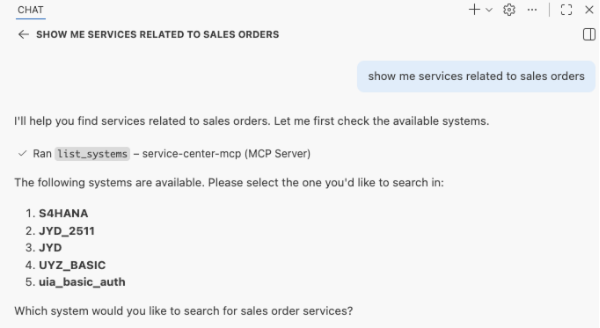

    If you selected a service host, enter the service path.

    AI Chat returns a list of matching services with basic details such as name, protocol, and description.

    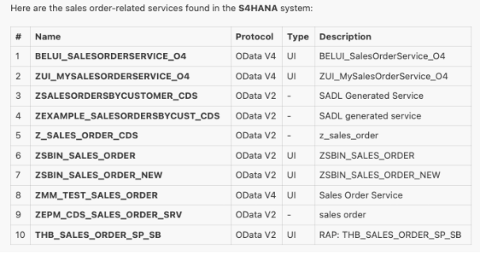

5.  If multiple services match the request, select the appropriate service.
6.  Review the returned service summary information.

    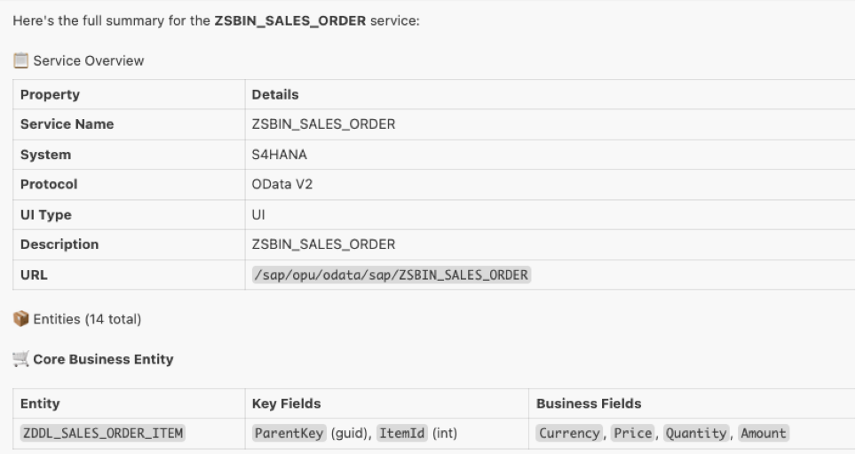

    > ### Note:  
    > The returned information is intended to help identify a relevant service and understand what it provides.
    > 
    > The same service details and metadata are also available through the [Service Center](https://help.sap.com/docs/bas/sap-business-application-studio/sap-system-service-provider?version=Cloud), which serves as an alternative interface for service exploration.

7.  \(Optional\) Ask follow-up questions to retrieve additional service details. For example:
    -   To learn about entities:

        ```
        Tell me more about the core business entity.
        ```

        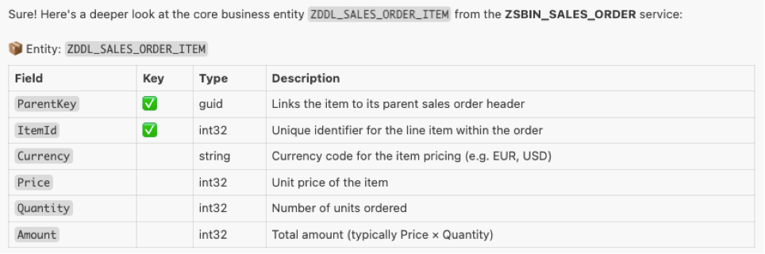

    -   To view live data \(if available\):

        ```
        View live data for this entity.
        ```

        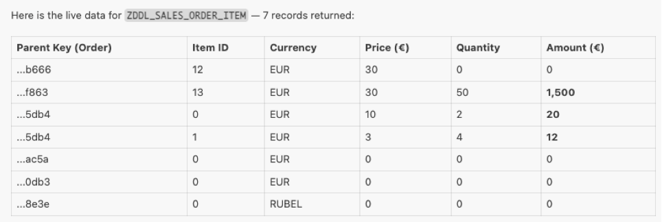

    -   Decide if you want to incorporate the service in your development. See [Create a CAP Application and Add an External Service](development-scenarios-with-ai-chat-1ac5995.md#loio1ac59957a09a4e83a57fd95f270e7dc1__capappwithsrvc).


## Create an SAP Fiori Application from an External OData Service

Use AI Chat to discover OData services from a connected SAP system and generate an SAP Fiori application.


### Prerequisites

-   Ensure that at least one relevant system is configured in your account.
-   Open the projects folder in your workspace to view generated files.
-   Ensure that the configured system has the required backend authorizations to access the OData service.

    > ### Note:  
    > Authentication is handled by the destination configuration, so AI Chat can discover services and generate applications without requiring you to manually enter credentials.


### Procedure

1.  Open **AI Chat**.
2.  If not already selected, select a model from the model selector.
3.  Enter a prompt to search for services on a connected system. For example:

    ```
    Show me services related to sales orders from the UI3 system.
    ```

4.  If prompted, select the system that contains the service.

    This step is required when multiple systems are available.

    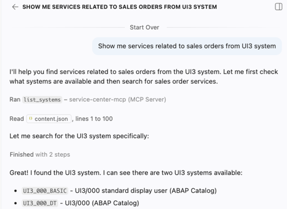

5.  Review the list of matching services returned by AI Chat. The service information can include the service name, protocol type, and service description.

    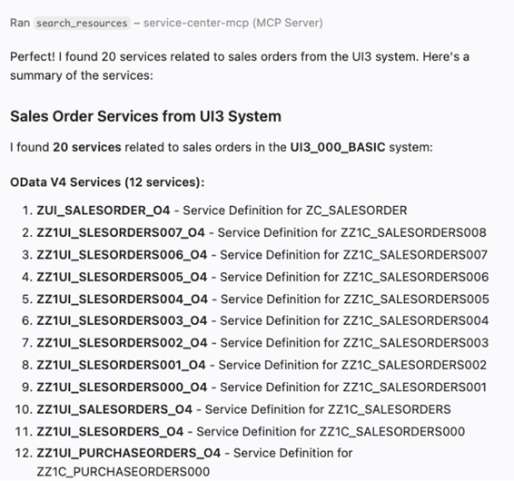

6.  Select the service that best matches your business requirement.
7.  In AI Chat, enter a prompt to create an SAP Fiori application based on the selected OData service. For example:

    ```
    Create an SAP Fiori application based on the ZUI_SALESORDER_O4 OData service.
    ```

    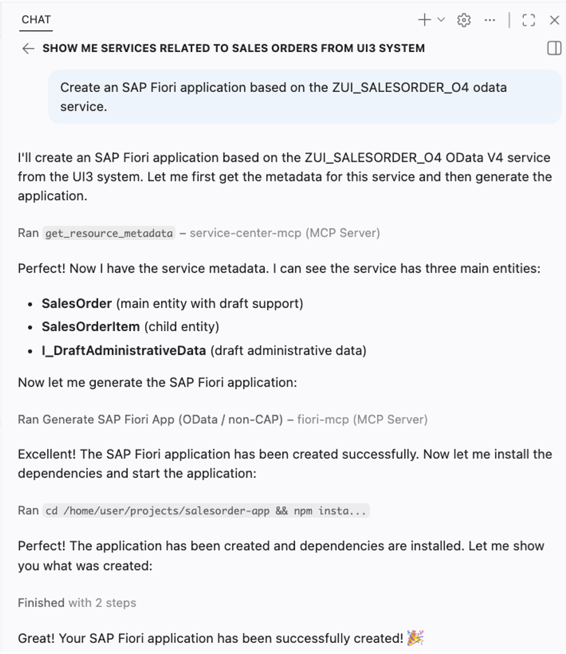

    AI Chat performs the following actions automatically:

    -   Retrieves the service metadata
    -   Analyzes available entities and annotations
    -   Generates the SAP Fiori application
    -   Configures the application to consume the selected OData service

8.  Review the generated application in your workspace.
9.  In AI Chat, enter the following prompt:

    ```
    Run the application with live data.
    ```

10. Verify that the application loads and retrieves live data from the OData service.

    You now have a running SAP Fiori application connected to the external OData service.

    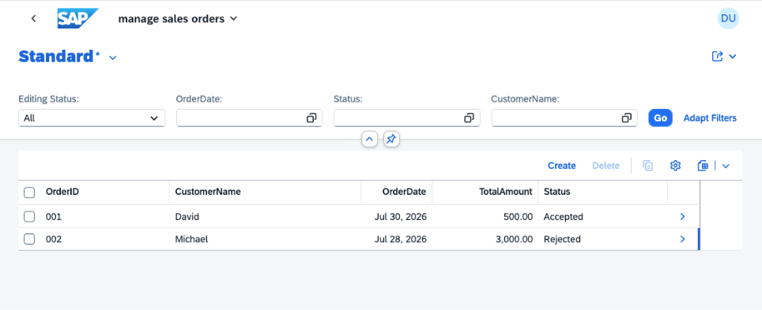


### Related Topics

-   [Add an External Service to an SAP Fiori Project](https://help.sap.com/docs/bas/sap-business-application-studio/sap-system-service-provider?version=Cloud#service-actions-for-development)


<a name="loio1ac59957a09a4e83a57fd95f270e7dc1__capappwithsrvc"/>

## Create a CAP Application and Add an External Service

Use AI Chat to create a CAP application with a list report SAP Fiori elements UI and initiate the addition of an external service.


### Prerequisites

-   Ensure that at least one relevant system is configured in your account.
-   Open the projects folder in your workspace to view generated files.
-   Ensure that the configured system has the required backend authorizations to access the OData service.

    > ### Note:  
    > Authentication is handled by the destination configuration, so AI Chat can discover services and generate applications without requiring you to manually enter credentials.


### Procedure

1.  In AI Chat, enter a prompt to create a CAP application.

    ```
    Create an SAP CAP application and UI for managing purchase contracts, suppliers, and contract budgets.
    Each contract budget should have a target amount and a spent amount.
    
    ```

    > ### Note:  
    > -   The chat displays a sequence of planned actions.
    > 
    >     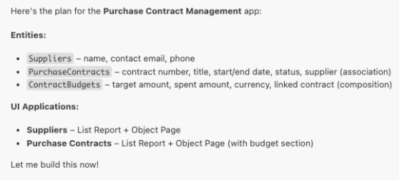
    > 
    > -   You may be prompted to confirm actions \(for example, select *Allow*, *Keep*, or enable auto-approval\).

2.  Review the generated project in your workspace.

    The project may include structure, data model, and sample data.

    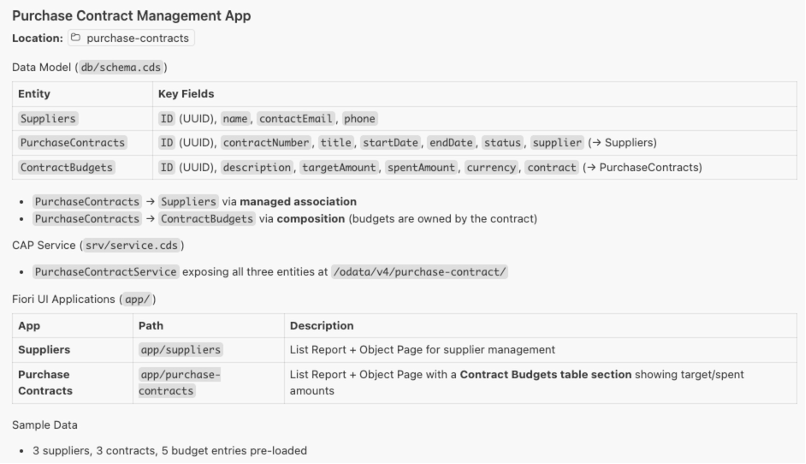

3.  In the chat, enter a second prompt to add and connect an external service:

    ```
    Find and add a sales order external service and connect it to the contract budget entity.
    Add sample data and include the sales order in the contract budget list report UI.
    
    ```

4.  If prompted:

    -   Select the system
    -   Select the service

    > ### Note:  
    > You may be prompted to confirm actions \(for example, select *Keep*, *Allow*, or enable auto-approval\).

    A CAP application with UI integration and a connection to the external service is generated and can be run.

    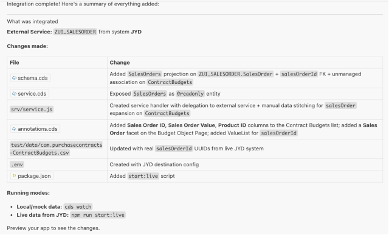

5.  Run the application using mock or live data.

    ```
    Run the app with live data
    ```

    > ### Tip:  
    > If the run fails because port 4004 is already in use, ask AI Chat to use a different port.

6.  Click *Open in a New Tab* to preview the app.

    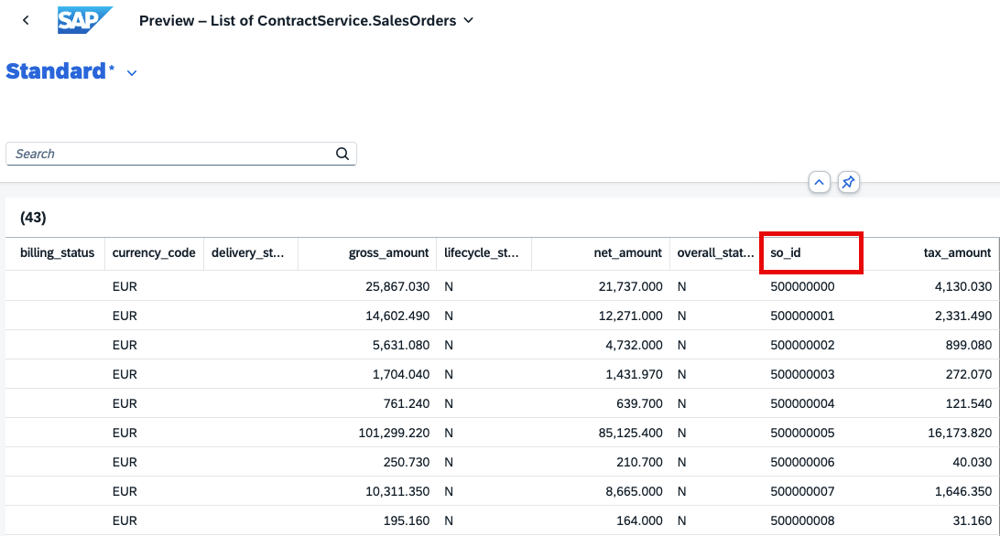


### Related Topics

-   [Add an External Service to a CAP Project](https://help.sap.com/docs/bas/sap-business-application-studio/sap-system-service-provider?version=Cloud#service-actions-for-development)
-   [CAP-level Service Integration](https://cap.cloud.sap/docs/guides/integration/calesi#odata-apis)


## Create a CAP Application and Add a Data Product

Use AI Chat to create a CAP application with a list report UI showing an imported data product, preview the application, and deploy it.


### Prerequisites

Ensure that the following prerequisites are completed:

-   SAP S/4HANA systems are assigned to SAP BTP formations for both design-time and runtime scenarios
-   A data product is shared with SAP HANA Cloud
-   A user-provided service exists in SAP BTP that grants database access
-   It is recommended to open the **projects** folder in the workspace to view generated files.

See [Explore Data Products in Unified Customer Landscape](https://help.sap.com/docs/bas/sap-business-application-studio/explore-data-products-in-unified-customer-landscape?version=Cloud#prerequisites-for-administrator-setup).


### Procedure

1.  In AI Chat, enter a prompt such as:

    ```
    Create an empty SAP CAP application. Find a supplier data product and integrate it into the SAP CAP application. Add an SAP Fiori UI.
    ```

2.  If prompted:

    1.  Select the system
    2.  Select the data product

        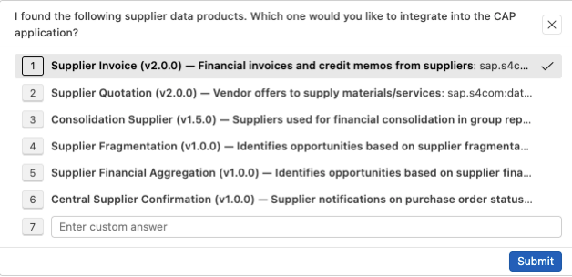

    3.  Confirm that you want to import the data product entities

        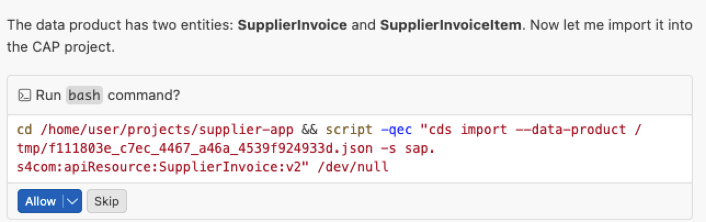

    4.  Provide the user-provided grant service name, which gives access to the database where the data product is installed.

        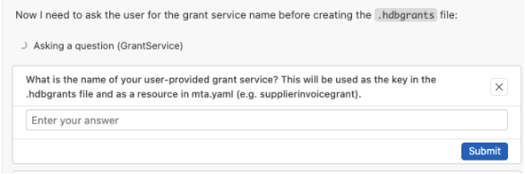


    > ### Note:  
    > You may be prompted to confirm actions \(for example, *Keep*, *Allow*, or *Continue*\).

    A CAP application is created with:

    -   Imported data product entities
    -   Service definitions
    -   UI components
    -   Required configuration files

    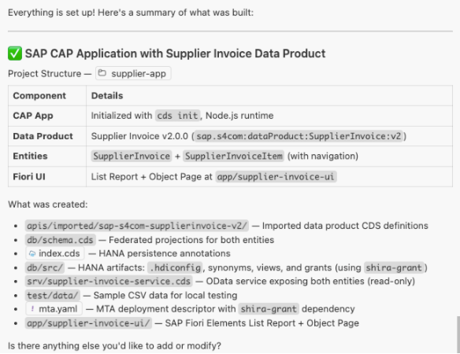

3.  Run the application using mock data.

    ```
    Run the app with mock data
    ```

4.  Open the application using *Open in a New Tab* or the provided link.

    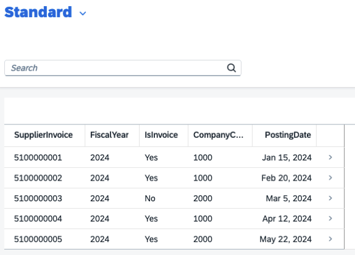

5.  Build and deploy the application to Cloud Foundry, if required.

    All database artifacts are generated.


### Related Topics

[Explore Data Products in Unified Customer Landscape](https://help.sap.com/docs/bas/sap-business-application-studio/explore-data-products-in-unified-customer-landscape?version=Cloud&locale=en-US#procedure)

