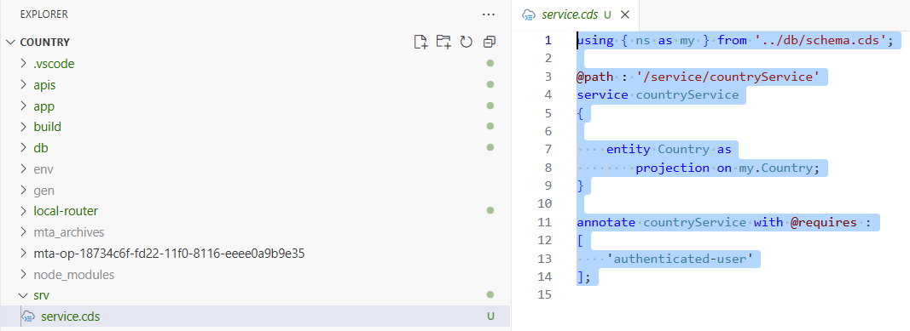
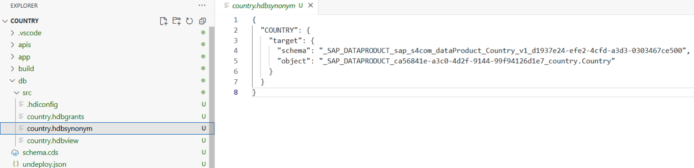
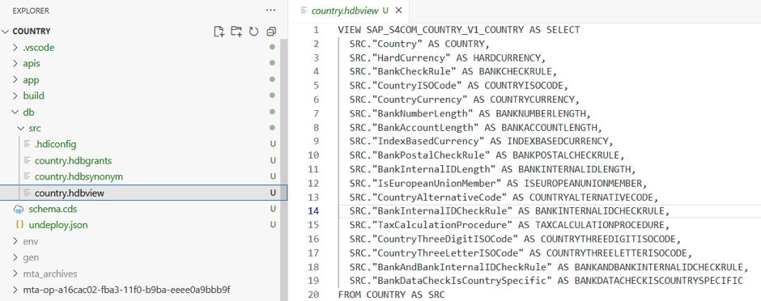
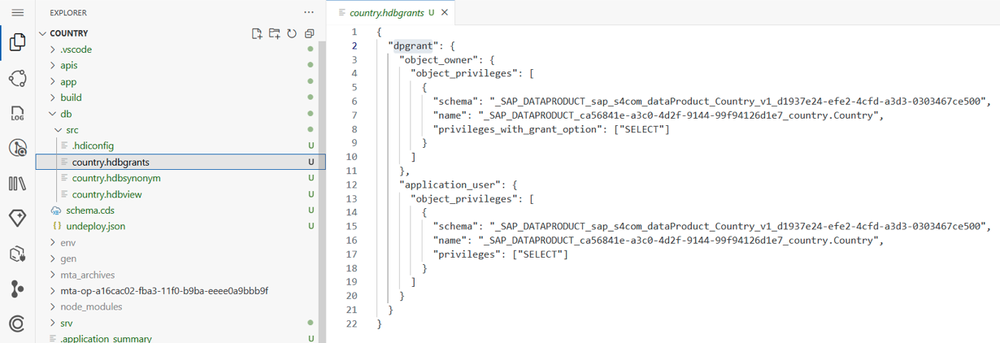
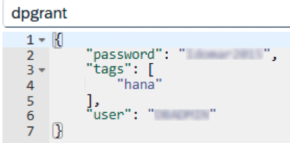
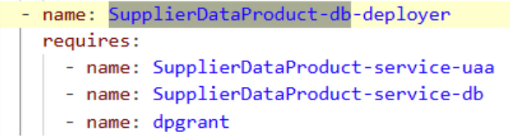
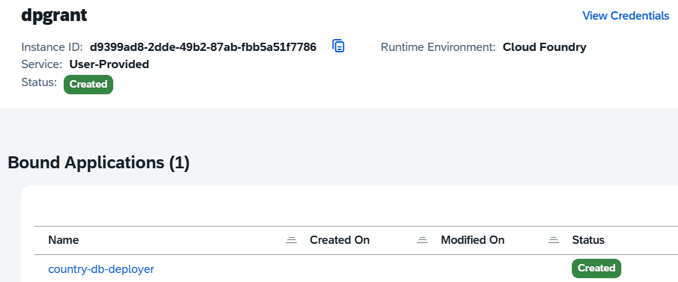
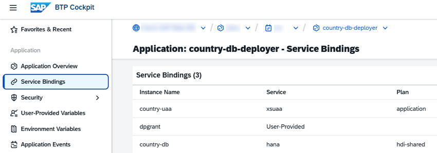

<!-- loio7aa6cc6b0d9845149636abf7f7d1a296 -->

# Explore Data Products in Unified Customer Landscape 

Access business-ready data products from SAP S/4HANA Cloud Private Edition using the Unified Customer Landscape service provider. You can review metadata and import data products as external data sources for application development.

A data product is a fully managed, ready-to-use business dataset from SAP or its partners, enriched with business metadata. Data products are easy to discover, preview, and consume across SAP solutions, such as SAP S/4HANA Cloud Private Edition and SAP Business Application Studio, for analytics, integration, and application development. For details, see [Data Product Support in SAP HANA Cloud](https://help.sap.com/docs/hana-cloud/sap-hana-cloud-administration-guide/data-product-support-in-sap-hana-cloud-internal?locale=en-US).

You can explore and import data products into your CAP projects using the Service Center.

> ### Note:  
> -   Data products are only available in the *Full-Stack Application Using Productivity Tools* dev space.
> -   This flow is not supported in trial accounts.


## Prerequisites for Administrator Setup

Before you can use data products, ensure that the following administrator tasks are completed:


### System Configuration

-   An SAP S/4HANA Cloud Private Edition system is registered in your SAP BTP global account.
-   You are onboarded to SAP Business Data Cloud. See [Onboarding](https://help.sap.com/docs/business-data-cloud/onboarding-guide-business-data-cloud/onboarding).
-   SAP Business Data Cloud and SAP S/4HANA Cloud Private Edition are connected. See [Integrating SAP S/4HANA Cloud Private Edition to SAP Business Data Cloud](https://help.sap.com/docs/business-data-cloud/administering-sap-business-data-cloud/set-up-connectivity-with-sap-s-4hana-cloud-private-edition?locale=en-US).
-   Assign systems to SAP BTP formations for both design time and runtime scenarios as required:


    <table>
    <tr>
    <th valign="top">

    Formation Name
    
    </th>
    <th valign="top">

    Assigned Systems
    
    </th>
    <th valign="top">

    Result
    
    </th>
    </tr>
    <tr>
    <td valign="top">
    
    *Developing with SAP Business Application Studio*
    
    </td>
    <td valign="top">
    
    SAP Business Application Studio, SAP S/4HANA Cloud Private Edition
    
    </td>
    <td valign="top">
    
    The Service Center in SAP Business Application Studio lists and allows exploration of data products from the registered SAP S/4HANA Cloud Private Edition system.
    
    </td>
    </tr>
    <tr>
    <td valign="top">
    
    *Integration with SAP Business Data Cloud*
    
    </td>
    <td valign="top">
    
    SAP Business Data Cloud, SAP S/4HANA Cloud Private Edition, SAP HANA Cloud

    > ### Note:  
    > To add an SAP HANA Cloud system, subscribe to SAP HANA tools and create an SAP HANA instance.


    
    </td>
    <td valign="top">
    
    SAP S/4HANA Cloud Private Edition content is available for activation and sharing in SAP Business Data Cloud. See [Integrating SAP S/4HANA Cloud Private Edition to SAP Business Data Cloud](https://help.sap.com/docs/business-data-cloud/administering-sap-business-data-cloud/set-up-connectivity-with-sap-s-4hana-cloud-private-edition?locale=en-US).
    
    </td>
    </tr>
    </table>
    


### Data Product Activation and Sharing

-   The data package must be activated in the SAP Business Data Cloud cockpit. See [Activate Data Packages](https://help.sap.com/docs/business-data-cloud/onboarding-guide-business-data-cloud/activating-data-packages#activate-data-packages).
-   The data product must be shared with SAP HANA Cloud from the SAP Business Data Cloud cockpit. See [Sharing to SAP HANA Cloud](https://help.sap.com/docs/business-data-cloud/governing-and-publishing-data-in-catalog/sharing-data-products-to-sap-systems#sharing-to-sap-hana-cloud).
-   The data product must be installed in SAP HANA tools. See [Install a Data Product \(SAP HANA Cloud Central\)](https://help.sap.com/docs/hana-cloud/sap-hana-cloud-administration-guide/install-data-product-sap-hana-cloud-central?locale=en-US#procedure).

    > ### Note:  
    > When installing the data product in SAP HANA Cloud Central, log in as the database \(DB\) user who should own and access it. Use the same credentials to create your user-provided service instance \(for example, `dpgrant`\) in SAP BTP. You can use any DB user with the necessary permissions \(instead of DBADMIN\) if preferred.


## Procedure

1.  Open the Service Center and choose *Data Product*.
2.  Choose a system.

    > ### Note:  
    > Only systems that meet the prerequisites and are assigned to the *Developing with SAP Business Application Studio* formation are listed.

3.  Select a package to view its available data products.
4.  Choose a data product.

    The editor displays entities, metadata, and a description.

5.  Review the entities and metadata to confirm suitability.
6.  In the editor, click *Add to CAP Project*.

    The Service Center imports the data product. The following changes occur:

    -   An `apis-imported` folder is created in your project, with a subfolder for each imported data product containing the CDS model, annotations, and `i18n` files.
    -   The project's `package.json` file is updated with a model of `"kind": "data.product"`.
    -   The imported data product is treated as an external \(remote\) model.

7.  Model the CAP application and point to the external data product entities:
    1.  Define your entity in the `schema.cds` file based on the imported data product.

        Example `schema.cds` file:

        ```
        namespace ns;
         
        using { sap.s4com.Country.v1.Country as dpCountry } from '../apis/imported/sap-s4com-country-v1/services';
         
        @federated entity Country as
            projection on dpCountry
            {
                Country,
                CountryThreeLetterISOCode,
                CountryThreeDigitISOCode,
                CountryISOCode
            };
        ```

    2.  Create a service based on that entity.

        Example `services.cds` file:

        


8.  You can now preview your application with mock data. See [Creating Run Configurations](https://help.sap.com/docs/bas/sap-business-application-studio/creating-run-configurations?version=Cloud&locale=en-US).
9.  Prepare your application for deployment:

    > ### Note:  
    > This step is required for now, but may not be needed in future releases.

    1.  Update the `schema.cds` file with this additional annotation:

        ```
        annotate dpCountry with @cds.persistence.exists
        ```

    2.  Create a synonym that points to the remote schema and table of the data product in the SAP HANA instance.

        Example synonym file:

        

    3.  Create an `.hdbview` file pointing to the synonym and ensure the synonym's fields are ALL CAPS. The view name should be based on the imported data product \(from Step 7a above\), replacing periods with underscores.

        Example `country.hdbview` file:

        

    4.  Create an `hdbgrants` file referencing the user-provided instance and granting required privileges for the schema and data product table in SAP HANA.

        Example `hdbgrants` file:

        


10. Set up database access using a user-provided instance:
    1.  Create a user provided instance in SAP BTP with SAP HANA credentials.

        

    2.  Update your `mta.yaml` file to register this instance as an existing service and bind it to the db module:

        ```
          - name: dpgrant
            type: org.cloudfoundry.existing-service
        ```

        

        Example user-provided instance:

        


11. Build and deploy the application.
12. After deploying, verify that the application and service bindings appear in the SAP BTP cockpit.

    

13. Run the application and view it in SAP BTP.

