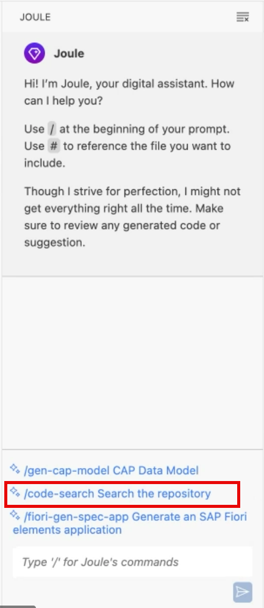

<!-- loio337848fc83f24738a9f3a15a88f1fa76 -->

# Generative AI-Powered Development

Joule, SAP's innovative AI chat, enables you to generate content for your project as well as a complete project, based on your business scenario.

> ### Restriction:  
> This option is only available if you are working in the `build-code` or the `build-default` plan. See [Application Plans](https://help.sap.com/docs/bas/sap-business-application-studio/application-plans?version=Cloud).

> ### Caution:  
> Joule in SAP Business Application Studio improves accuracy by using your project's source code files as context. Therefore, please ensure these files do not contain any personal data.

This section describes the general Joule capabilities. To learn more about the options available for your business scenario, see Develop Business Applications.

<a name="loio337848fc83f24738a9f3a15a88f1fa76__section_krf_xbx_wcc"/>

## Code Search

Enables semantic search for code within your workspace.

1.  Open Joule \(\) from the activity bar.
2.  At the bottom on the pane, select*/code search Search the repository*.

    

3.  Use natural language to tell Joule what you are looking for.
4.  The first time you perform a search, it may take some moments for the results to appear because the workspace content needs to be indexed. Click *Continue* in the notification.

The results show the files relevant to your search criteria.

Now that the workspace has been indexed, the next time you perform a code search, Joule suggests prompts based on your previous search. You can click on one of the suggested prompts or enter a new one manually.

SAP Business Application Studio indexes any new file added to the workspace.

### To disable this feature:

1.  Go to *Manage* \> *Settings*.
2.  Search for *Code Search*.
3.  Deselect the *Code Search: Auto Indexing Enabled* checkbox.

**Related Information**  

[Enable or Disable AI Features](https://help.sap.com/docs/bas/sap-business-application-studio/enable-or-disable-ai-features)

