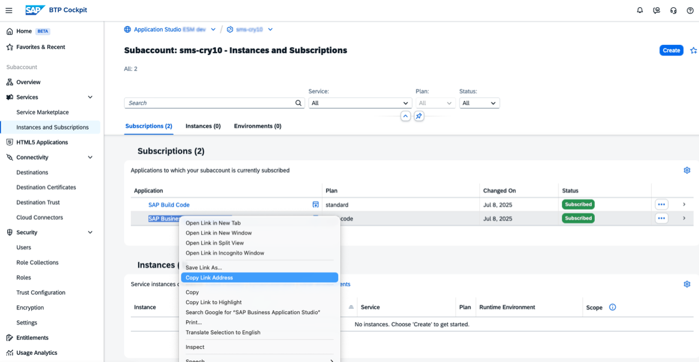

<!-- loio56e1d0c7dd0b43819848a821d74893c2 -->

# Migrate to the Identity Authentication Service

Switching from XSUAA authentication to the Identity Authentication service is recommended for SAP Business Application Studio instances using the build-code or build-default plans, especially when integrated with other SAP Build services. This ensures compatibility and harmonization, aligning all services under a unified authentication method for seamless integration and future readiness.

Currently, SAP Business Application Studio uses the SAP Authentication and Trust Management service \(XSUAA\) for identity authentication. Migrating to the SAP Cloud Identity Services - Identity Authentication service, involves changing the authentication mechanism via an API, ensuring consistent authentication across services without affecting the authentication flow of other subaccount services. It's important to note that this change is irreversible once implemented.


## Prerequisites

Before proceeding with the migration, make sure you perform the following steps:

-   Make sure you have administrator privileges for your SAP Business Application Studio instance. See [Manage Authorizations and Roles](manage-authorizations-and-roles-01e69c5.md).
-   Check your subaccount's configuration:
    -   If using the Identity Authentication service with the Security Assertion Markup Language \(SAML\) protocol, follow SAP Note [3311563](https://help.sap.com/docs/link-disclaimer?site=https://me.sap.com/notes/3311563) to migrate to OpenID Connect \(OIDC\).
    -   If already using the Identity Authentication service with the OIDC protocol, no additional steps are needed.


-   For a new subaccount, create a trust relationship between the Identity Authentication service and SAP BTP.

    For more information, see [Establish Trust and Federation Between SAP Authorization and Trust Management Service and SAP Cloud Identity Services](https://help.sap.com/docs/btp/sap-business-technology-platform/establish-trust-and-federation-between-uaa-and-identity-authentication?version=Cloud).


## Migrate Using the Admin Tool

To migrate from XSUAA to the Identity Authentication service authentication:

1.  Open the Admin Tool.

    ```
    https://<landscape-url>/workspace-manager-ui/admin/index.html
    ```

2.  Go to the *Migration* tab.
3.  In the *Migrate to the Identity Authentication Service* section, click *Migrate*.
4.  Confirm the migration.


## Migrate Using the API

To migrate from XSUAA to the Identity Authentication service authentication:

1.  Make sure you have a REST API tool, such as Postman, to manage API requests .
2.  Determine your SAP Business Application Studio URL:
    1.  Open your SAP BTP subaccount and navigate to *Instances and Subscriptions*.
    2.  Locate *SAP Business Application Studio* in the list of subscriptions.
    3.  Right-click *SAP Business Application Studio*.
    4.  Select *Copy Link Address* \(or the equivalent option in your browser\).

        

    5.  Use the copied URL as the `<sap-business-application-studio-url>` value.

3.  Open a web browser and send the following request:

    ```
    GET https://<sap-business-application-studio-url>/jwt 
    ```

4.  Copy the JWT token from the response.
5.  In the browser, send a GET HTTP request to the following API:

    ```
    GET https://<sap-business-application-studio-url>/ws-manager/api/v1/metadata
    
    ```

6.  Copy the `host` property value from the response.
7.  In the REST API tool, send a PUT HTTP request to the following API:

    ```
    PUT https://<host_value>/tenant-manager/api/v1/admin/switchToSAPCloudIdentityAuthenticationService
    
    Request Header:
    Authorization: Bearer <JWT_token>
    ```

    > ### Note:  
    > After running the API, *sms* is added as a prefix to the application technical name when viewing the SAP Business Application Studio subscription from the *Instances and Subscriptions*.


## Post Migration Steps

After migrating from XSUAA to the Identity Authentication service, reconfigure the following settings since they were initially set up with XSUAA:

-   Identity Authentication application-level configurations, including corporate IdP trust and assertions.
-   Role collection mapping for the specified IdP.
-   Creation of shadow users and potential manual mapping, as existing mappings retain the old IdP ID from XSUAA.

For more information about the post migration steps, see [Business Users](https://help.sap.com/docs/btp/sap-business-technology-platform/business-users-2e684942eb964befa435b5ed6702824a?locale=en-US).

